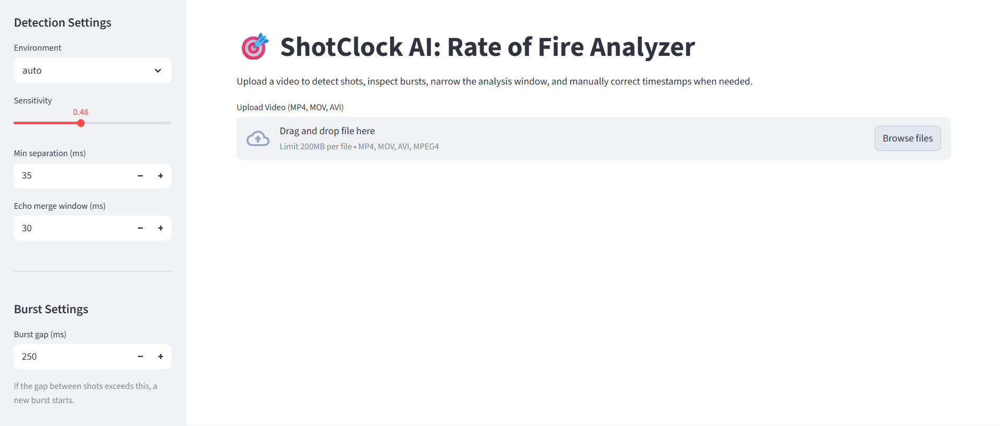
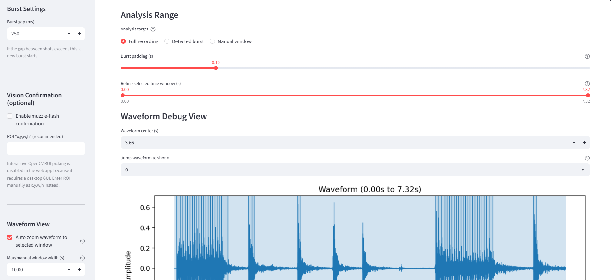

# ShotClock-AI


**ShotClock‑AI** is a high‑precision acoustic **rate‑of‑fire (ROF) analysis tool** designed to detect impulsive events such as firearm shots from **audio or video sources**.

The system extracts shot timestamps, groups bursts, and calculates detailed rate‑of‑fire statistics while suppressing echoes and acoustic artifacts.

The detector is built around **robust signal‑processing techniques rather than simple peak detection**, allowing it to perform reliably in challenging acoustic environments.

---

# Features

## Shot Detection

ShotClock‑AI identifies impulsive acoustic events using multiple signal features:

- Adaptive noise-floor thresholding (driven by the sensitivity setting)
- Crest factor, kurtosis and peak prominence
- Spectral shape (high-frequency share, flatness) and rise time
- Sample-accurate onset timing (~1 ms)
- Echo rejection that learns each recording's reflection delay, plus
  relative-loudness checks against the preceding shot

Candidate onset peaks are scored by a small logistic-regression classifier
(`src/rof_detector/audio/scoring.py`, weights in `audio/model.json`) trained
on the synthetic regression dataset instead of a hand-tuned formula. If
`model.json` is missing, detection falls back to the original heuristic
scoring automatically. See **Training the Shot Classifier** below.

These techniques allow reliable operation even with:

- echoes
- background noise
- close‑interval shots
- microphone artifacts

---

## Burst Detection

Detected shots are automatically grouped into **bursts** based on timing gaps between events.

Burst grouping allows the system to distinguish between:

- semi‑automatic fire
- controlled bursts
- sustained automatic fire

---

## ROF Statistics

ShotClock‑AI computes detailed rate‑of‑fire metrics including:

- Mean RPM
- Median RPM
- Percentile RPM
- Maximum RPM
- Burst‑level ROF statistics
- Split times between shots
- Cadence consistency metrics

---

## Robustness Improvements

The detector includes logic to handle difficult recording conditions:

- Echo reflections
- Close‑interval shots (double taps)
- Mechanical clicks
- Microphone bumps
- Background noise
- Variable microphone gain

---

# Installation

Clone the repository:

```bash
git clone https://github.com/Stuck7hrottle/ShotClock-AI.git
cd ShotClock-AI
```

Create a virtual environment:

```bash
python -m venv .venv
source .venv/bin/activate
```

Install the package:

```bash
pip install -e .
```

The CLI command will now be available:

```bash
rof
```

---

# Basic CLI Usage

Run detection on an audio file:

```bash
rof detect input.wav
```

Run detection on a video file:

```bash
rof detect input.mp4
```

Save JSON results:

```bash
rof detect input.wav --out results.json
```

Export CSV results:

```bash
rof detect input.wav --csv results.csv
```

Generate waveform plot:

```bash
rof detect input.wav --plot waveform.png
```

---

# CLI Parameters

| Parameter | Description |
|----------|-------------|
| `--sensitivity` | Detection sensitivity |
| `--min-separation-ms` | Minimum allowed time between shots |
| `--echo-window-ms` | Echo suppression window |
| `--burst-gap-ms` | Gap used to split bursts |
| `--environment` | Optional preset tuning |

Example:

```bash
rof detect audio.wav     --sensitivity 0.48     --min-separation-ms 35     --echo-window-ms 30
```

---

# Default Detection Tuning

Recommended production defaults:

```
sensitivity = 0.48
min_separation_ms = 35
echo_window_ms = 30
burst_gap_ms = 250
```

These values were derived using the **synthetic regression dataset** included with the project.

They balance:

- echo rejection
- close‑shot detection
- transient noise suppression

---

# Output Format

Example JSON output:

```json
{
  "events": [
    {
      "t": 0.5006,
      "confidence": 0.97,
      "audio_score": 0.97
    }
  ],
  "rof": {
    "cyclic_rpm": 801.3,
    "mean_rpm": 245.1,
    "max_rpm": 820.4
  },
  "bursts": []
}
```

- `cyclic_rpm`: rate within bursts only (splits up to `--burst-gap-ms`). This is
  the gun's rate of fire and the number to quote.
- `mean_rpm`: shots per minute from the first shot to the last, pauses included
  (60 / mean split).
- Per-burst `mean_rpm` in `burst_summary` is 60 x (shots - 1) / burst duration.

---

# Streamlit Web Interface

ShotClock‑AI includes an optional **interactive Streamlit interface** for visual inspection and manual verification of detections.

Run the interface:

```bash
streamlit run ui/streamlit_app.py
```

Open your browser:

```
http://localhost:8501
```

(or your configured reverse‑proxy domain).

---

# Interactive Analysis Workflow

Typical workflow:

1. Upload a **video (MP4/MOV/AVI) or WAV file**
2. The detector runs automatically (results are cached, so moving sliders is instant)
3. Choose an **analysis target**
4. Inspect the waveform and **listen** to any shot or rejected candidate
5. Correct detections if necessary and click **Apply edits**
6. Export results, and optionally the corrected labels as **training data**

The interface is designed for **manual verification and detailed analysis** of complex recordings.

---

# Analysis Target Modes

### Full Recording

Analyze the entire audio track.

### Detected Burst

Select a burst detected by the algorithm.

Optional **burst padding** prevents clipping the first or last shot.

### Manual Window

Select any arbitrary time window in the recording.

Useful when:

- the detector misses bursts
- noise events confuse burst detection
- analyzing a specific time segment

---

# Waveform Inspection

The interface includes a waveform viewer showing:

- detected shot timestamps
- candidates the detector rejected (dotted), with the reason
- burst groupings
- selected analysis window

Features include:

- automatic waveform zoom based on the selected burst/window
- adjustable waveform center
- manual zoom control
- ability to jump directly to detected shots

This allows users to visually confirm that impulses correspond to real shots.

---

# Manual Shot Editing

Detected shots can be edited directly in the interface.

Users can:

- remove false positives
- adjust timestamps
- add missed shots
- add back rejected candidates with one click

Edits are kept while moving between bursts and windows; **Reset to detected**
discards them.

After edits the system automatically recomputes:

- burst grouping
- ROF statistics
- cadence metrics

This enables precise correction in difficult acoustic environments.

---

# Exporting Results

### CSV

Shot‑level statistics including:

- timestamp
- split time
- instantaneous RPM

### JSON

Full analysis report including:

- detection parameters
- burst statistics
- ROF metrics
- edited event list
- rejected candidates

### Training data (ZIP)

The audio plus your corrected shot times for the selected window, in the same
layout as `test_audio_v2/`. See **Training the Shot Classifier**.

---

# Project Structure

```
ShotClock-AI
│
├── rof_detector
│   ├── cli.py
│   ├── detect.py
│   ├── audio.py
│
├── test_audio
├── test_audio_v2
│
├── generate_test_audio.py
├── generate_test_audio_v2.py
│
├── batch_analyze.py
├── batch_analyze_v2.py
│
├── streamlit_app.py
│
└── README.md
```

---

# Tuning the Detector

ShotClock‑AI includes tools for **systematic tuning and regression testing**.

Two scripts generate synthetic audio datasets:

```
generate_test_audio.py
generate_test_audio_v2.py
```

The advanced generator produces:

- filtered echoes
- impulse variation
- nuisance transients
- environmental noise

---

# Generating Test Audio

Basic dataset:

```bash
python generate_test_audio.py
```

Advanced dataset:

```bash
python generate_test_audio_v2.py
```

This produces:

```
test_audio_v2/
    *.wav
    ground_truth.json
```

The ground truth file contains expected shot timestamps.

---

# Training the Shot Classifier

Onset-peak scoring is a logistic-regression model trained on the synthetic
regression dataset rather than hand-tuned weights. Retrain it after changing
`generate_test_audio_v2.py` or adding new scenarios:

```bash
python generate_test_audio_v2.py
python train_shot_classifier.py
```

This holds out `08_slow_fire_with_bumps`, `09_double_taps_boundary`,
`10_noisy_env_harsh`, `13_echo_vs_doubletap_ambiguous`,
`15_burst_then_aimed_singles` and `17_mixed_semi_and_auto_outdoor_echo` from
training and reports validation precision/recall on them, then writes
`src/rof_detector/audio/model.json`. Run `python batch_analyze_v2.py`
afterward to confirm overall precision/recall/F1 didn't regress before
committing a retrained model.

### Training on real recordings

Synthetic audio only goes so far: real phone recordings have codec artifacts,
automatic gain control and clipping that the generator does not model. The
single most effective way to improve detection is to add real labeled clips:

1. In the web UI, review a clip, fix any mistakes and click **Apply edits**.
2. Download **Training data (ZIP)** and unzip it, e.g. into `real_clips/`.
3. Retrain with the real clips included:

```bash
python train_shot_classifier.py --extra real_clips/*
```

Only the window you reviewed is used for training, so unreviewed parts of a
long recording don't become false labels.

---

# Batch Analysis

Evaluate detection performance:

```bash
python batch_analyze_v2.py
```

Example output:

```
Expected primary shots: 156
Detected events:         152
True positives:          150
False positives:         2
False negatives:         6
Precision:               98.68%
Recall:                  96.15%
F1 score:                97.40%
```

The script also produces a JSON regression report.

---

# Important Test Scenarios

| Scenario | Purpose |
|---------|---------|
| steady cadence | baseline accuracy |
| fast burst | high RPM |
| echo chamber | echo suppression |
| jittery cadence | irregular firing |
| interference | transient noise |
| slow fire | isolated shots |
| double taps | close‑interval detection |
| burst then aimed singles | isolated shots next to bursts |
| wall echo, fixed delay | echoes longer than the merge window |
| mixed semi/auto, outdoor echo | everything at once |

---

# Recommended Tuning Workflow

1. Generate advanced test audio

```bash
python generate_test_audio_v2.py
```

2. Run regression analysis

```bash
python batch_analyze_v2.py
```

3. Adjust parameters

```
sensitivity
min_separation_ms
echo_window_ms
```

4. Re‑run regression tests

Focus on these challenging scenarios:

```
05_interference_and_clicks
08_slow_fire_with_bumps
09_double_taps_boundary
```

---

# Performance Benchmarks

Using the included regression dataset:

| Metric | Result (`batch_analyze_v2.py` defaults) |
|------|------|
| Precision | 98.7% |
| Recall | 96.2% |
| F1 Score | 97.4% |

(17 scenarios, 156 shots; the previous detector scored 89.8% F1 on the same
set at its old defaults and 90.6% at these defaults. Validation F1 on the
held-out scenarios is 0.90. Rerun
`batch_analyze_v2.py` yourself after any detector or dataset change — these
numbers are only as good as the synthetic scenarios they're measured on)

The system maintains high recall while preserving accurate burst timing and ROF statistics.

---

# Real‑World Audio Limitations

Performance may degrade when:

- microphone clipping occurs
- heavy audio compression is applied
- strong mechanical impacts occur near the microphone
- echoes arrive very close to the direct impulse
- heavy crowd noise is present

Best practices:

- use uncompressed audio
- avoid automatic gain control
- keep microphones within reasonable distance

---

# Development Goals

Planned improvements:

- environment presets
- improved transient classification
- multi‑channel microphone support
- GPU‑accelerated signal analysis
- optional vision‑based shot confirmation

---

# Contributing

Pull requests and improvements are welcome.

When submitting tuning changes please include:

- updated regression results
- batch analysis output
- explanation of parameter changes

---

# License

MIT License

---

# UI Preview




